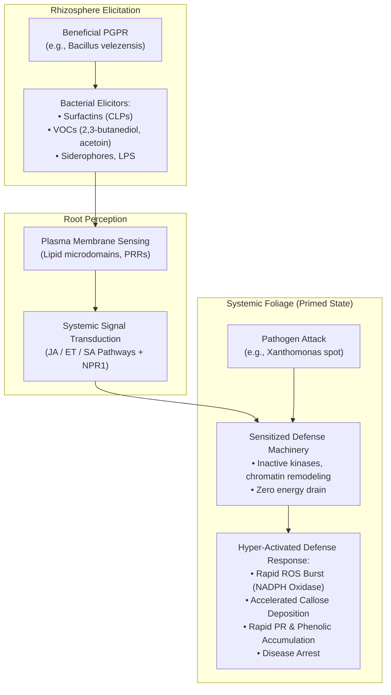

# Induced Systemic Resistance (ISR)

## Overview
**Induced Systemic Resistance (ISR)** is a physiological state of enhanced defensive capacity developed by plants following root or localized colonization by non-pathogenic, beneficial microorganisms—predominantly Plant Growth-Promoting Rhizobacteria (PGPR) such as *[[bacillus-velezensis]]*, *Bacillus subtilis*, and fluorescent *Pseudomonas* species, as well as plant-beneficial fungi like *Trichoderma*. Unlike Systemic Acquired Resistance (SAR), which is incited by necrotizing pathogens and is accompanied by high baseline metabolic costs, classical ISR typically operates via **defense priming**, equipping distant plant tissues to deploy faster and stronger immune responses upon subsequent pathogen attack without suppressing vegetative growth or yield.

## ISR vs. SAR: Comparative Immunology

| Feature | Systemic Acquired Resistance (SAR) | Induced Systemic Resistance (ISR) |
|---|---|---|
| **Primary Trigger** | Necrotizing foliar pathogens; chemical activators (e.g., Acibenzolar-S-methyl [ASM]) | Beneficial root-colonizing rhizobacteria (PGPR), endophytes, mycorrhizae |
| **Hormonal Pathway** | **Salicylic Acid (SA)**-dependent | Classically **Jasmonic Acid (JA) / Ethylene (ET)**-dependent (some PGPR trigger SA-dependent ISR) |
| **Key Regulatory Protein** | NPR1 (nuclear translocation of monomeric NPR1) | NPR1 (acts downstream as a cytoplasmic coordinator of JA/ET signaling) |
| **Diagnostic Markers** | Direct, high-level accumulation of *PR* genes (*PR-1*, *PR-2*, *PR-5*) prior to attack | Enhanced capacity for defense (*priming*); negligible *PR* expression until pathogen challenge |
| **Defense Mechanism** | Direct accumulation of antimicrobial proteins | Accelerated oxidative burst (ROS), callose papillae, MAPK cascades, phytoalexins |
| **Fitness Cost to Plant** | Significant allocation costs; growth and yield reductions under continuous induction | Negligible energetic cost in the absence of pathogens (*priming advantage*) |

## The "Defense Priming" Paradigm
The hallmark of ISR is **defense priming** (sensitization):
1. **The Primed State**:
   - Beneficial bacteria colonize the rhizosphere, releasing elicitors into the root zone.
   - The systemic foliage enters an alert state without turning on heavy transcription of energy-intensive antimicrobial proteins. This avoids the "trade-off penalty" between plant growth and disease resistance.
2. **The Challenged State**:
   - When a virulent pathogen (such as *[[xanthomonas-perforans]]*) lands on a primed plant leaf and attempts to penetrate via stomata, the primed host perceives the invader much earlier.
   - It executes an explosive biphasic reactive oxygen species (ROS) burst mediated by plant NADPH oxidases (RbohD/RbohF), deposits callose collars around penetration sites, activates MAPK3/6 phosphorylation cascades, and halts pathogen multiplication in the apoplast.

## Microbial Elicitors in *Bacillus*-Mediated ISR
Rhizobacteria utilize structurally diverse chemical signals to initiate ISR:
- **Cyclic Lipopeptides (CLPs)**:
  - **Surfactin**: Inserts into plant plasma membrane outer monolayers, causing transient microdomain alterations that open mechanosensitive $\text{Ca}^{2+}$ channels without causing lytic leakage (see [[cyclic-lipopeptides]]).
  - **Bacillopeptin X**: Identified in *B. velezensis* YC7010, driving systemic protection against both insect pests and bacterial blights.
- **Microbial Volatile Organic Compounds (mVOCs)**:
  - **2,3-Butanediol & Acetoin (3-hydroxy-2-butanone)**: Small, uncharged molecules that readily diffuse across soil and air, binding plant receptors to stimulate ethylene and JA cascades. Engineered *B. velezensis* overproducing acetoin triggers significantly stronger ISR against *Pseudomonas syringae* (Peng et al., 2019).
- **Cell Wall & Surface Macromolecules**:
  - Lipopolysaccharides (LPS), flagellin (flg22), and peptidoglycan fragments recognized by plant cell-surface Pattern Recognition Receptors (PRRs).

## Local Root Immune Quenching vs. Distal Foliar Priming
A fundamental spatial dichotomy characterizes the relationship between beneficial rhizobacteria and their host:
- **Local Root Scale (Immune Quenching)**: To colonize roots without triggering constitutive immune activation and growth-defense tradeoffs, beneficial rhizobacteria (*Pseudomonas* WCS358/WCS417) produce D-gluconic acid to acidify the root apoplast (pH 3.5–3.7), completely quenching local MAMP-triggered ROS bursts (see [[rhizosphere-immune-modulation]]).
- **Distal Shoot Scale (Systemic Priming)**: Despite quenching local root immunity, these colonizing bacteria transmit long-distance vascular signals that prime systemic foliar tissues for enhanced resistance against foliar attackers.

## Application in Crop Health & Integrated Management
- **Overcoming Fungicide/Bactericide Resistance**: Because ISR acts through the host's endogenous immune physiology rather than directly poisoning the pathogen, it does not exert direct biochemical selection for target-site mutations. It is highly effective against copper-resistant *Xanthomonas* populations (see [[copper-bactericides-and-resistance]]).
- **Synergistic Stacking**: Co-application of PGPR elicitors (e.g., *[[bacillus-velezensis]]* GF267) with low-dose chemical plant activators (e.g., ASM) produces additive, long-lasting systemic protection in commercial tomato and pepper fields.

## References & Sources
- Yu, K., Liu, Y., Tichelaar, R., Savant, N., Lagendijk, E., van Kuijk, S. J. L., Stringlis, I. A., van Dijken, A. J. H., Pieterse, C. M. J., Bakker, P. A. H. M., Haney, C. H., & Berendsen, R. L. (2019). Rhizosphere-associated *Pseudomonas* suppress local root immune responses by gluconic acid-mediated lowering of environmental pH. *Current Biology*, 29(23), 3913–3920. [[raw/papers/yu2019rhizosphere.pdf]]
- Rabbee, M. F., Hwang, B. S., & Baek, K. H. (2023). *Bacillus velezensis*: A beneficial biocontrol agent or facultative phytopathogen for sustainable agriculture. *Agronomy*, 13(3), 840. [[raw/papers/rabbee2023bacillus.pdf]]
- Pieterse, C. M. J., et al. (2014). Induced systemic resistance by beneficial microbes. *Annual Review of Phytopathology*, 52, 347–375.
- van Loon, L. C., Bakker, P. A., & Pieterse, C. M. (1998). Systemic resistance induced by rhizosphere bacteria. *Annual Review of Phytopathology*, 36(1), 453–483.
- Ongena, M., et al. (2007). Surfactin and fengycin lipopeptides of *Bacillus subtilis* as elicitors of induced systemic resistance in plants. *Environmental Microbiology*, 9(4), 1084–1090.
- Peng, G., et al. (2019). Engineering *Bacillus velezensis* with high production of acetoin primes strong induced systemic resistance in *Arabidopsis thaliana*. *Microbiological Research*, 227, 126297.
