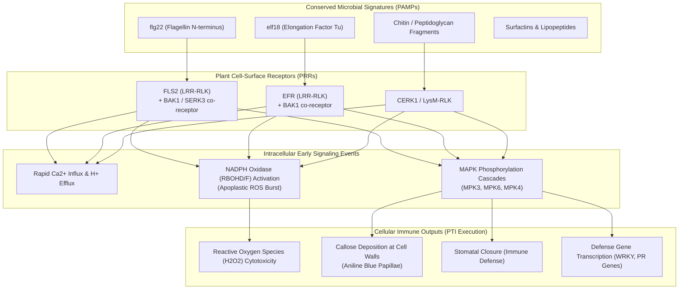

# PAMP-Triggered Immunity (PTI)

## Overview
**PAMP-Triggered Immunity (PTI)**—also referred to as **Pattern-Triggered Immunity** or Microbe-Associated Molecular Pattern (MAMP)-Triggered Immunity—constitutes the foundational, evolutionarily ancient first active defense layer of the plant immune system. Formally conceptualized in the landmark "Zig-Zag Model" (Jones & Dangl, 2006), PTI is initiated when host cell-surface Pattern Recognition Receptors (PRRs) detect conserved, indispensable microbial molecular signatures termed Pathogen- or Microbe-Associated Molecular Patterns (PAMPs/MAMPs). Activation of PTI orchestrates rapid apoplastic defenses that halt colonization by non-adapted microbes and curtail the virulence of adapted pathogens.

## Molecular Recognition: PAMPs and Host PRRs

### Landmark PAMP-PRR Pairs
- **flg22 $\rightarrow$ FLS2**: A 22-amino-acid peptide derived from the conserved N-terminus of bacterial flagellin (from *Pseudomonas*, *Xanthomonas*, or *Acidovorax*), perceived by the leucine-rich repeat receptor-like kinase (LRR-RLK) **FLS2** (Flagellin Sensitive 2) in complex with co-receptor **BAK1 / SERK3**.
- **elf18 $\rightarrow$ EFR**: An 18-amino-acid peptide from bacterial elongation factor Tu (EF-Tu), recognized by the LRR-RLK **EFR** in brassicaceous species and transgenic solanaceous crops.
- **Chitin Fragments $\rightarrow$ CERK1 / LYK**: Fungal cell wall oligomers recognized by LysM-containing receptor kinases.

## Hallmark Cellular Outputs of PTI Execution

### 1. The Oxidative Burst (Apoplastic ROS)
- Within minutes of PAMP perception, plant plasma membrane-bound **NADPH oxidases** (Respiratory Burst Oxidase Homologs, primarily **RBOHD** and **RBOHF**) transfer electrons from cytosolic NADPH to apoplastic oxygen, generating superoxide radicals ($\text{O}_2^{\cdot-}$), which rapidly dismutate into hydrogen peroxide ($\text{H}_2\text{O}_2$).
- **Quantitative Detection Methodologies**:
  - **HRP-Luminol Chemiluminescence Assay**: In leaf discs, horseradish peroxidase (HRP) oxidizes luminol in the presence of apoplastic $\text{H}_2\text{O}_2$, yielding luminescence recorded in real-time as Relative Light Units (RLU). Widely used to evaluate the kinetics of flg22- and EIX-elicited ROS generation (Gupta et al., 2024).
  - **Fluorescent $\text{H}_2\text{DCFDA}$ Microscopy**: Permeable 2',7'-dichlorodihydrofluorescein diacetate is deacetylated and oxidized into green-fluorescent 2',7'-dichlorofluorescein (DCF) by intracellular and apoplastic ROS, allowing in situ visualization under confocal fluorescence microscopy (Chang et al., 2019).
- Functions of the ROS Burst:
  - Direct antimicrobial cytotoxicity against invading bacteria.
  - Substrate for peroxidase-mediated oxidative cross-linking of cell wall structural proteins (lignin, suberin).
  - Rapid systemic signaling trigger alerting neighboring cells.
- **Pharmacological Validation**: Specific inhibition of plant NADPH oxidases by **diphenyleneiodonium chloride (DPI)** completely suppresses the ROS burst, demonstrating its enzymatic dependence on host RBOHs.
- **Microenvironmental Acidification & Immune Quenching**: The magnitude of the apoplastic ROS burst is exquisitely sensitive to extracellular pH. Lowering the ambient pH to 3.5–3.7 (via bacterial secretion of D-gluconic acid by beneficial *Pseudomonas* or oxalic acid by *Sclerotinia sclerotiorum*) **completely abolishes the flg22-triggered ROS burst**, serving as a physiological mechanism to quench root immunity and prevent growth-defense tradeoffs (Yu et al., 2019; see [[rhizosphere-immune-modulation]]).
- **Priming by Beneficial Bacilli**: Both *[[bacillus-velezensis]]* (Chang et al., 2019) and *[[bacillus-thuringiensis]]* (Gupta et al., 2024) significantly prime and intensify this ROS surge upon challenge with bacterial or fungal PAMPs, with heat-inactivated bacterial MAMPs remaining capable of inducing the primed oxidative response.

### 2. Callose Deposition (Cell Wall Fortification)
- Within 4 to 12 hours of PRR activation, plant cells mobilize callose synthases (e.g., **PMR4 / GSL5**) to synthesize and deposit $\beta$-(1,3)-glucan polymers (**callose**) between the plasma membrane and outer cell wall directly beneath pathogen penetration sites.
- Callose papillae physically reinforce the cell wall, restrict stomatal aperture, and block the intercellular delivery of bacterial Type III effectors. In laboratory assays, callose accumulation is visualized and quantified by **0.01% aniline blue fluorometric microscopy** (excitation 340–380 nm, emission 400–425 nm).

### 3. Stomatal Defense & MAPK Signaling
- Guard cells recognize bacterial PAMPs (flg22, lipopolysaccharides) via surface PRRs, triggering nitric oxide (NO) and abscisic acid (ABA)-dependent stomatal closure within 1 hour, effectively closing natural invasion portals.

## PTI Intensification & Defense Priming by Beneficial Microbes
A critical frontier in molecular plant pathology is the **intensification (priming) of PTI** by plant growth-promoting rhizobacteria (PGPR), notably *[[bacillus-velezensis]]* and *Bacillus amyloliquefaciens* (Chang et al., 2019):
- **Mechanism of Intensification**:
  - Beneficial *Bacillus* strains (e.g., PMB04 and PMB05) produce elicitors (surfactins, volatile compounds) that sensitize host PRR signaling complexes without triggering toxic tissue necrosis.
  - When primed host tissue (such as watermelon, *[[citrullus-lanatus]]*) subsequently encounters a virulent pathogen (*[[acidovorax-citrulli]]*) or pure PAMP (flg22), the host executes an accelerated, hyper-amplified ROS burst (**up to 2,733-fold higher** than baseline within 1 hour) and a massive surge in callose papillae (over 150-fold).
- **Decoupling Antagonism from Immunity**:
  - Comparative studies reveal that strains with the highest in vitro antibiotic halos (e.g., *B. thuringiensis* DR81) often perform poorly in field disease suppression if they fail to prime host PTI. In contrast, strains that intensify PTI (PMB04, PMB05) achieve over 95% protection against seedling blight and bacterial fruit blotch, proving that host immunity priming is often the decisive biocontrol determinant.

## References & Sources
- Yu, K., Liu, Y., Tichelaar, R., Savant, N., Lagendijk, E., van Kuijk, S. J. L., Stringlis, I. A., van Dijken, A. J. H., Pieterse, C. M. J., Bakker, P. A. H. M., Haney, C. H., & Berendsen, R. L. (2019). Rhizosphere-associated *Pseudomonas* suppress local root immune responses by gluconic acid-mediated lowering of environmental pH. *Current Biology*, 29(23), 3913–3920. [[raw/papers/yu2019rhizosphere.pdf]]
- Gupta, R., Keppanan, R., Leibman-Markus, M., Matveev, S., Rav-David, D., Shulhani, R., Elad, Y., Ment, D., & Bar, M. (2024). *Bacillus thuringiensis* promotes systemic immunity in tomato, controlling pests and pathogens and promoting yield. *Food Security*, 16(3), 675–690. [[raw/papers/gupta2024bacillus.pdf]]
- Chang, C. J., Wu, Y. H., Lin, Y. H., Deng, W. L., & Lin, C. H. (2019). Intensification of PAMP-triggered immunity in watermelon by *Bacillus* spp. strains as a strategy for controlling bacterial fruit blotch disease. *Journal of Plant Medicine*, 61(1), 39–48. [[raw/papers/chang2019intensification.pdf]]
- Jones, J. D. G., & Dangl, J. L. (2006). The plant immune system. *Nature*, 444(7117), 323–329.
- Boller, T., & Felix, G. (2009). A renaissance of elicitors: perception of microbe-associated molecular patterns and danger signals by pattern-recognition receptors. *Annual Review of Plant Biology*, 60, 379–406.
- Luna, E., et al. (2011). Callose deposition: a multifaceted plant defense response. *Molecular Plant-Microbe Interactions*, 24(2), 183–193.
- Torres, M. A. (2010). ROS in biotic interactions. *Physiologia Plantarum*, 138(4), 414–429.
