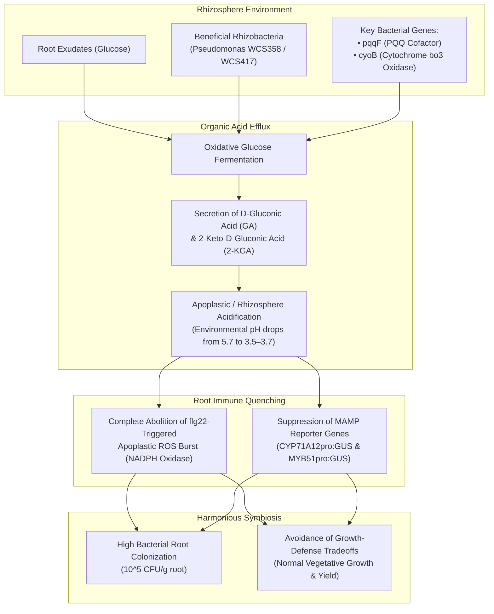

# Rhizosphere Immune Modulation & Acidification

## Overview
Plants inhabit a microbe-dense soil environment where roots are continuously surrounded by high concentrations of Microbe-Associated Molecular Patterns (MAMPs), including bacterial flagellin (flg22), peptidoglycan, and elongation factors. In the plant foliage, perception of these signatures by cell-surface Pattern Recognition Receptors (PRRs) triggers robust **[[pamp-triggered-immunity]] (PTI)**. However, if root cells were to continuously execute defense cascades in response to the surrounding microbiome, the plant would suffer catastrophic growth arrest and biomass reduction due to severe **growth-defense tradeoffs**. 

Seminal work by Yu et al. (2019) resolved this **"root immune paradox"**, revealing that **42% of natural root microbiota** actively quench local root immune responses. Beneficial rhizobacteria, most notably plant growth-promoting *Pseudomonas* species (e.g., *Pseudomonas capeferrum* WCS358, *Pseudomonas simiae* WCS417), actively suppress MAMP-triggered root immunity by secreting organic acids that lower the microenvironmental pH, thereby abolishing the apoplastic **Reactive Oxygen Species (ROS) oxidative burst** and enabling peaceful root colonization.

## The Biochemical Mechanism of Acidification-Mediated Quenching

### 1. Genetic Determinants: *pqqF* and *cyoB*
Through a high-throughput mini-Tn5 transposon mutant screen in *P. capeferrum* WCS358 using an *Arabidopsis thaliana* MAMP-reporter line (*CYP71A12pro:GUS*), Yu et al. identified two indispensable bacterial genes required for root immune suppression:
- ***pqqF***: Encodes a protease essential for the biosynthesis of **pyrroloquinoline quinone (PQQ)**, an essential non-proteinaceous redox cofactor for membrane-bound bacterial glucose dehydrogenases.
- ***cyoB***: Encodes subunit I of the terminal ubiquinol **cytochrome $bo_3$ oxidase** complex embedded in the bacterial cytoplasmic membrane, which couples respiratory electron transport to proton pumping and metabolic gene regulation.

### 2. Synthesis of Gluconic Acids
- Working together, PQQ-dependent dehydrogenases and the CYO terminal oxidase oxidize glucose present in root exudates into **D-gluconic acid (GA)** and its derivative **2-keto-D-gluconic acid (2-KGA)**.
- Ultra-performance liquid chromatography-mass spectrometry (UPLC-MS) confirmed that wild-type *Pseudomonas* WCS358 and WCS417 secrete high levels of GA and 2-KGA, whereas *pqqF::Tn5* mutants are completely devoid of both organic acids, and *cyoB::Tn5* mutants lose 2-KGA production.

### 3. Microenvironmental pH Drop and ROS Abolition
- Secretion of GA and 2-KGA sharply drops the pH of culture filtrates and the root apoplastic microenvironment from initial pH 5.7 down to **pH 3.5–3.7**.
- **Complete Suppression of the Oxidative Burst**: Lowering the ambient pH to 3.7 (using either gluconic acid or mineral hydrochloric acid, HCl) **completely abolishes the flg22-triggered apoplastic ROS burst** in root cells.
- **Hormone-Independent Action**: Root immune suppression by organic acid-mediated acidification is completely functional in Arabidopsis hormone-signaling mutants (*sid2-2*, *npr1-1*, *jar1-1*, *jin1-7*), confirming that it operates via direct biophysical modulation of the apoplast rather than plant salicylic acid (SA) or jasmonic acid (JA) hormonal signaling.

## Ecological Necessity: Colonization vs. Growth-Defense Tradeoff
Why do beneficial rhizobacteria suppress root immunity?
1. **Facilitating Rhizosphere Colonization**:
   - Transposon mutants impaired in gluconic acid synthesis (*pqqF::Tn5* and *cyoB::Tn5*) exhibited significantly reduced population densities in the *Arabidopsis* rhizosphere (dropping from $10^5\text{ CFU/g root}$ in wild-type down to $10^{4.5}\text{ CFU/g}$).
   - This proves that local suppression of MAMP-triggered root immunity is mandatory for bacteria to establish high-density epiphytic biofilms on the root surface.
2. **Preventing Deleterious Growth-Defense Tradeoffs**:
   - When roots are exposed to continuous flg22 in the absence of immune-quenching bacteria, seedling fresh weight is severely reduced (up to 70% growth inhibition).
   - By buffering the root elongation zone against chronic PAMP activation, gluconic acid-producing rhizobacteria allow the host plant to maintain normal cell division, elongation, and vegetative biomass while growing in a MAMP-saturated soil environment.

## The Spatial Dichotomy of Beneficial Microbes: Local Quenching vs. Systemic Priming
A remarkable conceptual revelation emerges when comparing root and shoot interactions:
- **At the Root Surface (Local Scale)**: Plant-beneficial bacteria (*Pseudomonas*, *[[bacillus-velezensis]]*) produce organic acids or modified MAMPs to **dampen and quench local root defenses**, preventing autoimmune-like root stunting.
- **In Distant Foliage (Systemic Scale)**: Concurrently, these colonizing bacteria transmit long-distance vascular signals (hormonal cues, volatile organic compounds, cyclic lipopeptides) that **prime distant leaves** for hyper-activated defense upon pathogen attack (see [[induced-systemic-resistance]]).

## References & Sources
- Yu, K., Liu, Y., Tichelaar, R., Savant, N., Lagendijk, E., van Kuijk, S. J. L., Stringlis, I. A., van Dijken, A. J. H., Pieterse, C. M. J., Bakker, P. A. H. M., Haney, C. H., & Berendsen, R. L. (2019). Rhizosphere-associated *Pseudomonas* suppress local root immune responses by gluconic acid-mediated lowering of environmental pH. *Current Biology*, 29(23), 3913–3920. [[raw/papers/yu2019rhizosphere.pdf]]
- Pieterse, C. M. J., et al. (2014). Induced systemic resistance by beneficial microbes. *Annual Review of Phytopathology*, 52, 347–375.
- Millet, Y. A., et al. (2010). Innate immune responses activated in *Arabidopsis* roots by microbe-associated molecular patterns. *The Plant Cell*, 22(3), 973–990.
- Cessna, S. G., et al. (2000). Oxalic acid, a pathogenicity factor for *Sclerotinia sclerotiorum*, suppresses the oxidative burst of the host plant. *The Plant Cell*, 12(11), 2191–2200.
