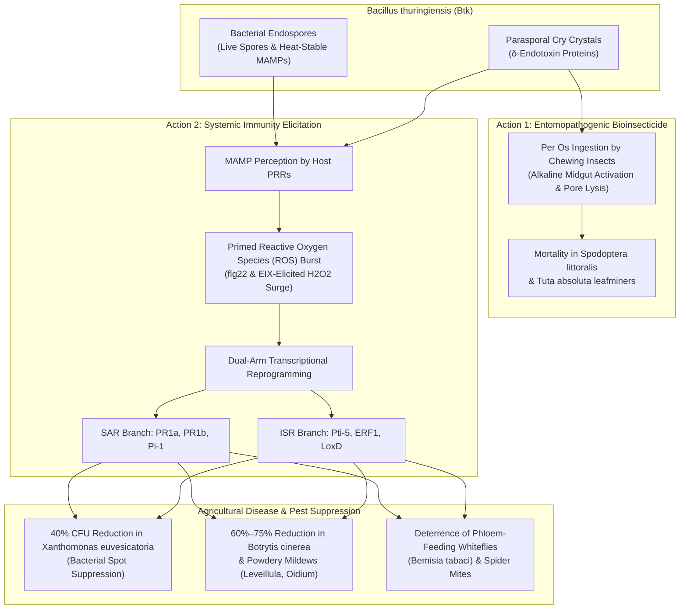

# Bacillus thuringiensis

## Overview
*Bacillus thuringiensis* (Bt) is a Gram-positive, spore-forming soil bacterium celebrated for over a century as the world's most widely used microbial bioinsecticide. Historically, commercial applications of Bt centered exclusively on its parasporal crystalline inclusions—composed of insecticidal crystal proteins (Cry and Cyt $\delta$-endotoxins)—which selectively perforate the midguts of susceptible insect larvae (Lepidoptera, Diptera, Coleoptera). However, breakthrough findings by Gupta et al. (2024) established a paradigm shift: *Bacillus thuringiensis* (specifically *B. thuringiensis* subsp. *krustaki*, Btk) functions as an effective plant-protecting endophyte and plant growth promoter that stimulates **systemic immunity** in crops such as tomato (*[[solanum-lycopersicum]]*). Bt primes the host **Reactive Oxygen Species (ROS) oxidative burst**, activating both Systemic Acquired Resistance (SAR) and Induced Systemic Resistance (ISR) to confer broad-spectrum protection against phytopathogenic bacteria (*[[xanthomonas-euvesicatoria]]*), necrotrophic/biotrophic fungi, and piercing-sucking arthropod pests.

## The Dual-Action Biocontrol Paradigm

## Priming of Reactive Oxygen Species (ROS) & Defense Kinetics
A central discovery in Bt-mediated phytoprotection is its capacity to prime the plant's oxidative defense machinery (Gupta et al., 2024):
- **ROS Measurement via HRP-Luminol Chemiluminescence**:
  - In tomato leaf discs harvested 24 h after final Bt treatment ($0.3\%\text{ v/v}$, $2 \times 10^{10}\text{ spores/mL}$), challenge with bacterial PAMP **flg22** or fungal elicitor **EIX (Ethylene-Inducing Xylanase)** elicited an immediate, dramatically amplified apoplastic ROS burst.
  - **flg22-elicited ROS**: Bt pre-treatment increased total relative light units (RLU) by up to **300%** compared to untreated control plants.
  - **EIX-elicited ROS**: Amplified from $\sim 500\text{ RLU}$ in water controls to over **$2,500\text{--}3,000\text{ RLU}$** in Bt-treated foliage.
- **Heat-Inactivation Stability & MAMP-Driven Priming**:
  - Crucially, boiling/heat-inactivation of Bt fractions (spores and crystals) **did not abolish ROS priming**. Both viable and heat-inactivated Bt fractions successfully primed the flg22- and EIX-induced ROS bursts.
  - This demonstrates that heat-stable Microbe-Associated Molecular Patterns (MAMPs) on the Bt spore envelope and crystal protein surfaces are sufficient to prime host pattern recognition receptors without requiring continuous bacterial metabolic viability.
- **Electrolyte Leakage vs. Phytotoxicity**:
  - Membrane electrolyte/ion leakage was transiently promoted only by viable native protein fractions, indicating mild localized cellular interactions. However, this interaction caused zero phytotoxic leaf scorching and did not suppress plant growth.

## Transcriptional Reprogramming: Dual SAR and ISR Activation
Unlike classical elicitors that trigger mutually antagonistic pathways (SA vs. JA cross-talk), Bt treatment coordinates a balanced, dual-arm defense response:
1. **Systemic Acquired Resistance (SAR) Arm**:
   - Dependent on viable spores and intact whole preparations.
   - Significantly upregulates salicylic acid-responsive defense transcripts: ***PR1a*** (Solyc01g106620), ***PR1b*** (Solyc00g174340), and ***Pi-1*** (pathogen-induced protein 1, Solyc01g097270).
2. **Induced Systemic Resistance (ISR) Arm**:
   - Stimulated by both viable and heat-inactivated Bt components.
   - Induces ethylene/jasmonic acid pathway markers: ***Pti-5*** (Pto-interacting ethylene-response factor transcription factor, Solyc02g077370), ***ERF1*** (Solyc05g051200), and ***LoxD*** (lipoxygenase D, Solyc03g122340).

## Spectrum of Agricultural Efficacy in Tomato

| Target Invader | Classification | Mode of Damage | Bt Efficacy & Mechanism |
|---|---|---|---|
| ***[[xanthomonas-euvesicatoria]]*** | Gram-negative bacterium | Bacterial spot, foliar water-soaking | **40% reduction in apoplastic CFU count**; marked reduction in water-soaked lesion severity |
| ***Botrytis cinerea*** | Necrotrophic fungus | Grey mould, foliar blight | **60% to 75% reduction in AUDPC**; active via foliar spray or root drench; also effective on bean, potato, and rapeseed |
| ***Leveillula taurica*** / ***Oidium neolycopersici*** | Biotrophic fungi | Powdery mildew | **Significant foliar disease suppression**; first confirmation of Bt efficacy against powdery mildew |
| ***Tuta absoluta*** | Lepidopteran insect | Tomato leafminer | Significant reduction in larval gallery numbers and damage severity; combination of Cry protein ingestion and plant defense |
| ***Bemisia tabaci*** | Hemipteran insect | Whitefly phloem feeding, TYLCV vector | Significant reduction in adult infestation rate and egg deposition mediated by host systemic immunity |
| ***Tetranychus urticae*** | Arachnid pest | Two-spotted spider mite | Significant reduction in mite numbers and chlorotic feeding damage via plant defense priming |

## Uncoupling the Growth-Defense Tradeoff
In plant biology, constitutive activation of systemic immunity often imposes an energetic drain, causing stunted growth and yield penalties. In contrast, Bt inoculation in tomato:
- Maintained normal mature plant height and leaf length.
- Significantly increased the number of stem nodes, young leaf length, and terminal leaflet surface area.
- Elevated marketable **fruit count and overall harvest yield** at the end of the season.
- This confirms that *Bacillus thuringiensis*-mediated immunity priming successfully uncouples the growth-defense tradeoff in solanaceous crops.

## Agronomic Implications for Sustainable Farming
- **Long Shelf-Life Advantage**: Because heat-inactivated Bt preparations retain ROS priming and pathogen disease suppression capabilities, Bt biopesticides possess exceptional shelf-life resilience under non-refrigerated tropical and sub-tropical storage conditions.
- **Combined Pest & Disease Formulation**: Farmers can deploy a single biological input to concurrently suppress foliar chewing pests (*Tuta absoluta*), sap-sucking viral vectors (*Bemisia tabaci*), and high-consequence bacterial spot pathogens (*X. euvesicatoria*).

## References & Sources
- Gupta, R., Keppanan, R., Leibman-Markus, M., Matveev, S., Rav-David, D., Shulhani, R., Elad, Y., Ment, D., & Bar, M. (2024). *Bacillus thuringiensis* promotes systemic immunity in tomato, controlling pests and pathogens and promoting yield. *Food Security*, 16(3), 675–690. [[raw/papers/gupta2024bacillus.pdf]]
- Sanahuja, G., et al. (2011). *Bacillus thuringiensis*: a century of research, development and commercial applications. *Plant Biotechnology Journal*, 9(3), 283–300.
- Leibman-Markus, M., et al. (2023). Immunity priming uncouples the growth-defense tradeoff in tomato. *Development*, 150(8), dev201158.
- Akram, W., et al. (2013). *Bacillus thuringiensis* strain 199 can induce systemic resistance in tomato against *Fusarium* wilt. *European Journal of Microbiology and Immunology*, 3(4), 275–280.
