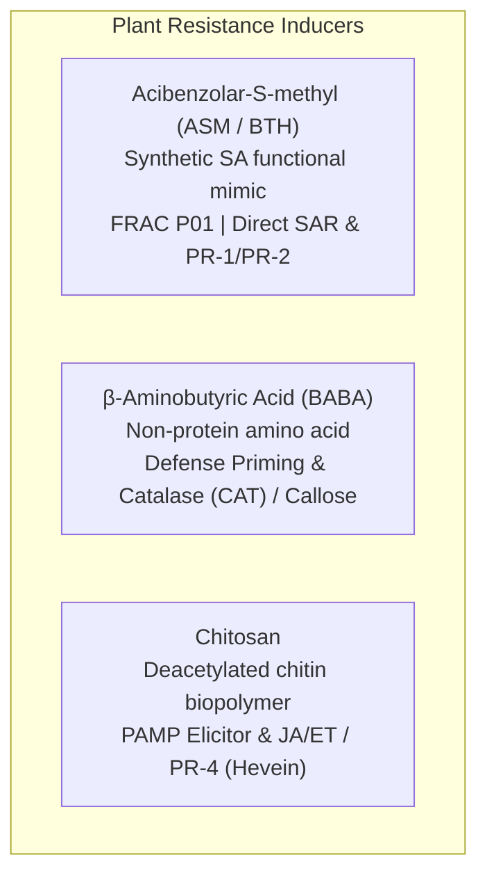

# Chemical Plant Resistance Inducers (PRIs)

## Overview
**Plant Resistance Inducers (PRIs)**—also termed plant defense activators or elicitors—are natural or synthetic chemical agents that protect crops from phytopathogens not by exerting direct toxic or bactericidal effects, but by stimulating the plant's endogenous immune system. In solanaceous crops such as pepper (*[[capsicum-annuum]]*) and tomato (*[[solanum-lycopersicum]]*), PRIs provide an effective, environmentally benign strategy to control [[bacterial-spot-tomato-pepper]] (*Xanthomonas* species complex), particularly where widespread resistance to copper bactericides (see [[copper-bactericides-and-resistance]]) has rendered conventional chemical sprays ineffective.

## Major Classes of Chemical Resistance Inducers

### 1. Acibenzolar-S-methyl (ASM / BTH) & Salicylic Acid (SA)
- **Classification**: Synthetic functional benzothiadiazole analogue of salicylic acid; classified under **FRAC Code P01** (host plant defense inducers). Commercial trade names include Actigard and Bion.
- **Biochemical Mode of Action**:
  - Acts downstream of salicylic acid synthesis, directly binding host receptors to induce conformational activation of master regulator **NPR1** (Non-Expressor of PR Genes 1).
  - Drives high-level transcriptional activation of classical SAR defense genes: ***PR-1*** (antimicrobial pathogenesis-related protein 1) and ***PR-2*** ($\beta$-1,3-glucanase).
  - In *Capsicum annuum*, foliar application of 0.5 mM ASM or SA 48 h prior to *Xanthomonas* inoculation stimulates a massive spike in *PR-1* (33- to 51-fold) and *PR-2* (up to 72-fold) transcription (Keawmanee et al., 2025).
  - GC-MS metabolomics reveals that ASM elicits the broadest metabolic reconfiguration among tested elicitors, activating over 30 unique secondary metabolites, including silyl derivatives and nitrogenous defense compounds.
- **Application Guidelines**: Must be applied preventively prior to pathogen arrival; has negligible curative or direct in vitro antibacterial activity against *Xanthomonas*.

### 2. $\beta$-Aminobutyric Acid (BABA)
- **Classification**: Non-protein amino acid priming agent.
- **Biochemical Mode of Action**:
  - Perceived by the plant aspartyl-tRNA synthetase receptor **IBI1** (Impaired in BABA-Induced Immunity 1).
  - Rather than driving heavy, energetically wasteful constitutive transcription of *PR* genes in unchallenged plants, BABA operates predominantly through **defense priming**.
  - **Antioxidant Homeostasis via Catalase (*CAT*)**: Following *Xanthomonas* challenge, BABA-treated pepper foliage sustains the highest expression of the catalase gene (***CAT***, up to 15.6-fold higher than controls at 72 h post-treatment). Catalase balances excess reactive oxygen species (ROS) from the defense burst, preventing uncontrolled foliar necrosis while facilitating rapid callose collar deposition and isothiocyanate production (e.g., methyl 3-isothiocyanatopropionate) (Keawmanee et al., 2025).

### 3. Chitosan
- **Classification**: Natural biopolymer of $\beta$-(1,4)-linked D-glucosamine derived from the deacetylation of crustacean chitin.
- **Biochemical Mode of Action**:
  - Functions as a Pathogen-Associated Molecular Pattern (PAMP) recognized by plant cell-surface Pattern Recognition Receptors (PRRs) containing LysM motifs.
  - Activates the octadecanoid pathway and **Jasmonic Acid (JA) / Ethylene (ET)** signaling cascades.
  - Drives early and specific transcription of ***PR-4*** (encodes hevein-like chitin-binding antimicrobial proteins; up to 5.9-fold induction at 24 h) and sustained *PR-2* expression.
  - Stimulates the accumulation of quinoline alkaloids, enhances total phenolics, and reinforces cell walls via lignification.
- **Application Notes**: Protection from a single chitosan spray is transient, peaking at 24–48 h and declining after 3–5 days, necessitating repeat applications or combination with root-colonizing bioinoculants.

## Inducer Efficacy Profile in Pepper (*Capsicum annuum*)
Empirical comparisons against *Xanthomonas euvesicatoria* (Keawmanee et al., 2025):

| Resistance Inducer | Class / Origin | Optimum Dose & Timing | Primary Marker Genes | Disease Severity Reduction | Key Advantages & Limits |
|---|---|---|---|---|---|
| **Acibenzolar-S-methyl (ASM)** | Synthetic (Benzothiadiazole) | 0.5 mM foliar spray (48 h pre-challenge) | *PR-1*, *PR-2* | 75%–80% (seedling); ~35% (flowering) | Potent SAR mimic; over-application can cause transient growth lag |
| **Salicylic Acid (SA)** | Endogenous phytohormone | 0.5 mM foliar spray (48 h pre-challenge) | *PR-1*, *PR-2* | 70%–75% | Core SAR pathway; subject to rapid plant catabolism / conjugation |
| **$\beta$-Aminobutyric Acid (BABA)** | Non-protein amino acid | 0.5 mM foliar spray (24–48 h pre-challenge) | *CAT* (Catalase), *PR-4* | 60%–70% | Excellent priming; zero baseline energy drain; controls post-infection ROS damage |
| **Chitosan** | Marine natural biopolymer | 1000 $\mu$L/L foliar spray (24 h pre-challenge) | *PR-4*, *PR-2* | 55%–65% | Organic-approved; physical barrier; requires repeated applications every 5–7 days |

## Synergistic Integration: The "PRI + *Bacillus*" IPM Framework
While single applications of chemical PRIs offer effective short-to-medium term disease reduction, integrating chemical inducers with root-drench applications of plant-beneficial bacilli (e.g., *[[bacillus-velezensis]]* CH6 or *Bacillus subtilis* B01) achieves the highest and most durable field control:
- **Spatial Complementarity**: Soil drenching of *Bacillus* establishes root colonization and long-term rhizospheric priming via JA/ET-dependent ISR and lipopeptides, while foliar sprays of ASM or SA activate local SA-dependent SAR in upper canopy tissues.
- **Durable Protection**: In flowering-stage bell pepper, soil drenching with *Bacillus* B01 restricted bacterial spot severity to 7.3% (an 85% reduction compared to 51.5% in untreated controls), outperforming single foliar chemical inducers.
- **Resistance Management**: By deploying multi-layered host physiological defenses, this integrated strategy overcomes copper-resistant and streptomycin-resistant *Xanthomonas* field races without generating chemical selection pressure.

## References & Sources
- Keawmanee, P., et al. (2025). Sustainable management of bacterial leaf spot in bell pepper by biological and chemical resistance inducers. *Agriculture*, 15(17), 1859. [[raw/papers/keawmanee2025sustainable.pdf]]
- Walters, D. R., et al. (2013). Controlling crop diseases using induced resistance: challenges for the future. *Journal of Experimental Botany*, 64(5), 1263–1280.
- Zimmerli, L., et al. (2000). $\beta$-Aminobutyric acid-induced resistance: a tool to study plant defense mechanisms. *Plant Physiology*, 124(3), 1293–1302.
- El Hadrami, A., et al. (2010). Chitosan in plant protection. *Marine Drugs*, 8(4), 968–987.
- Oostendorp, M., et al. (2001). Induced disease resistance in plants by chemicals. *European Journal of Plant Pathology*, 107(1), 19–28.
