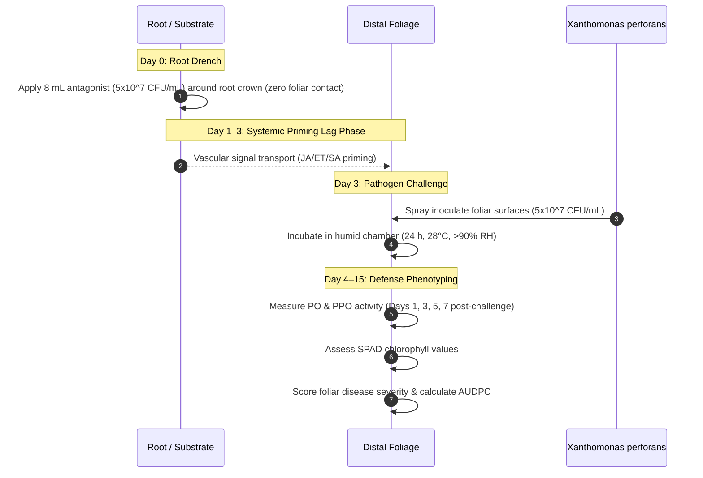

# Spatial Separation Assay for Induced Systemic Resistance (ISR)

## Principle & Purpose
A major experimental challenge in biological control research is determining whether a beneficial rhizobacterium (e.g., *[[bacillus-velezensis]]*) protects host plants via direct antibiosis/competition or by priming host defense machinery via [[induced-systemic-resistance]] (ISR). The **spatial separation assay** physically decouples the site of antagonist application (e.g., root crown / soil rhizosphere) from the site of pathogen challenge (e.g., distal upper foliage). By precluding direct contact between the antagonist and the pathogen, any observed reduction in disease severity or pathogen proliferation can be definitively attributed to plant-mediated systemic signaling rather than direct physical or chemical antagonism.

## Materials & Reagents
1. **Plant Material**: Uniform 4- to 5-true-leaf stage tomato (*[[solanum-lycopersicum]]* cv. Santa Clara or Moneymaker) or pepper seedlings grown in sterilized potting substrate.
2. **Antagonist Inoculum**: Fresh 24-h culture of beneficial bacteria (e.g., *B. velezensis* GF267) suspended in sterile distilled water, adjusted spectrophotometrically ($\text{OD}_{600} \approx 0.1$) to $\sim 5 \times 10^7\text{ CFU/mL}$.
3. **Pathogen Inoculum**: Fresh 24- to 48-h culture of *[[xanthomonas-perforans]]* suspended in sterile distilled water and adjusted to $\sim 5 \times 10^7\text{ CFU/mL}$.
4. **Enzyme Extraction Buffers**:
   - Sodium phosphate buffer (0.1 M, pH 6.0) for Peroxidase (PO) extraction.
   - Sodium phosphate buffer (0.1 M, pH 6.5) containing 1% polyvinylpyrrolidone (PVP) for Polyphenoloxidase (PPO) extraction.
   - Substrates: Guaiacol (0.5%) and hydrogen peroxide ($\text{H}_2\text{O}_2$, 0.08 M) for PO; catechol (0.05 M) for PPO.
5. **Equipment**: Spectrophotometer, SPAD-502 Plus chlorophyll meter, microcentrifuge, humid chamber (>90% RH).

## Step-by-Step Procedure

### 1. Antagonist Application (Root Treatment)
1. Select uniform tomato seedlings at the 4-leaf stage.
2. Pipette 8 mL of antagonist cell suspension ($\sim 5 \times 10^7\text{ CFU/mL}$) directly onto the potting medium immediately around the root crown.
3. **Crucial Precaution**: Completely prevent splashing or aerosol contact with the aerial parts of the seedling. For control treatments, apply 8 mL of sterile tap water.
4. Maintain treated plants in a growth chamber at 24°C–28°C for 72 hours (3 days) to establish rhizosphere colonization and enable vascular signal transmission.

### 2. Pathogen Challenge (Foliar Inoculation)
1. At 3 days post-rhizosphere application (0 DAI), atomize the foliar canopy with *X. perforans* suspension ($\sim 5 \times 10^7\text{ CFU/mL}$) until runoff using a handheld pressurized sprayer.
2. Transfer inoculated plants immediately into a humid chamber (>90% relative humidity, 26°C) for 24 hours to maintain stomatal opening and promote bacterial infection.
3. Return plants to greenhouse benches arranged in a completely randomized design with at least 7 to 9 biological replications.

### 3. Disease Severity & AUDPC Assessment
1. Evaluate disease severity daily or every 2 days from 3 to 20 days after inoculation (DAI) on the 3rd and 4th fully expanded leaves.
2. Use standardized diagrammatic severity scales (e.g., Mello et al., 1997) to grade the percentage of necrotic and water-soaked leaf area.
3. Calculate the Area Under the Disease Progress Curve (AUDPC) via Campbell and Madden (1990):
   $$\text{AUDPC} = \sum_{i=1}^{n-1} \left( \frac{y_i + y_{i+1}}{2} \right) (t_{i+1} - t_i)$$
   where $y_i$ is disease severity at time $t_i$.

### 4. Biochemical Defense Enzyme Assays
1. Harvest leaf discs (100–200 mg fresh weight) from treated and control plants at 1, 3, 5, 7, and 11 DAI.
2. Homogenize leaf tissue in liquid nitrogen and extract with 2 mL of ice-cold phosphate buffer. Centrifuge at $12,000 \times g$ for 15 min at 4°C.
3. **Peroxidase (PO) Activity**: Mix $50\ \mu\text{L}$ enzyme extract with $2.95\ \text{mL}$ substrate buffer (guaiacol + $\text{H}_2\text{O}_2$). Record absorbance at 470 nm every 30 s for 15.5 min.
4. **Polyphenoloxidase (PPO) Activity**: Mix $100\ \mu\text{L}$ enzyme extract with $2.9\ \text{mL}$ catechol solution. Record absorbance at 420 nm every 10 s for 5 min.

## Critical Notes & Troubleshooting
- **Avoiding False Positives from Aerosol Contamination**: If antagonist bacteria inadvertently touch leaf surfaces during root drenching, direct antibiosis will confound the assay. Always use barrier shields (e.g., Parafilm or plastic collars over pots) during root application.
- **Microclimate Sensitivity**: Disease severity of *X. perforans* is highly temperature-dependent, peaking at temperatures $\ge 25^\circ\text{C}$. In cooler glasshouses (<20°C), symptoms may be delayed, obscuring the window of early enzyme elevation (Days 3–5).
- **Transient Nature of Root-Mediated Protection**: As demonstrated by Mates et al. (2019), a single root drench of *B. velezensis* GF267 significantly delays symptom onset for the first 5 days via an accelerated oxidative burst; after 7–8 days, disease curves can converge unless repeat drenches or optimized formulations are applied.

## Citations & Standard References
- Mates, A. K., Pontes, N. C., & Halfeld-Vieira, B. A. (2019). *Bacillus velezensis* GF267 as a multi-site antagonist for the control of tomato bacterial spot. *Biological Control*, 137, 104013. [[raw/papers/mates2019bacillus.pdf]]
- Halfeld-Vieira, B. A., et al. (2015). Understanding the mechanism of biological control of passionfruit bacterial blight promoted by autochthonous phylloplane bacteria. *Biological Control*, 80, 40–49.
- Campbell, C. L., & Madden, L. V. (1990). *Introduction to Plant Disease Epidemiology*. John Wiley & Sons, New York.
