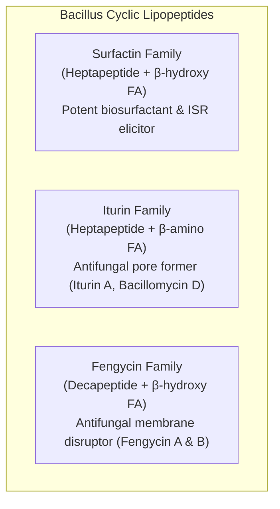

# Cyclic Lipopeptides (CLPs)

## Overview
**Cyclic lipopeptides (CLPs)** are a diverse class of secondary metabolites produced non-ribosomally by plant-beneficial bacilli (notably *[[bacillus-velezensis]]*, *Bacillus subtilis*, and *Bacillus amyloliquefaciens*) and fluorescent pseudomonads. Structurally composed of a cyclic oligopeptide headgroup coupled to a hydrophobic fatty acid tail, CLPs serve multi-faceted biological functions: they act as powerful biosurfactants for bacterial motility and biofilm architecture, form lytic pores in membranes of competing phytopathogenic fungi and bacteria, and serve as microbe-associated molecular patterns (MAMPs) that trigger plant [[induced-systemic-resistance]] (ISR).

## Biosynthetic Architecture (Modular NRPS)
CLPs are assembled independently of ribosomes by giant multienzymatic mega-complexes termed **Non-Ribosomal Peptide Synthetases (NRPS)**:
- **Modular Assembly Line**: Each module sequentially incorporates a specific amino acid into the growing peptide chain. A canonical elongation module contains:
  - **Adenylation (A) domain**: Selects and activates the specific amino acid substrate as an aminoacyl-AMP.
  - **Peptidyl Carrier Protein (PCP) / Thiolation (T) domain**: Covalently tethers the activated monomer via a 4'-phosphopantetheine prosthetic arm.
  - **Condensation (C) domain**: Catalyzes peptide bond formation between upstream and downstream intermediates.
  - **Epimerization (E) domain**: Inverts L-amino acids to D-stereoisomers (essential for metabolic stability and resistance to plant proteases).
  - **Thioesterase (TE) domain**: Positioned at the terminal module; catalyzes intramolecular cyclization (forming a macrolactone ring) and product release.

## The Three Landmark CLP Families in *Bacillus*

### 1. Surfactin Family (Heptapeptides)
- **Primary Members**: Surfactin, Lichenysin, Pumilacidin.
- **Biosynthetic Genetics & Amino Acid Sequence**:
  - Encoded by the $\sim 26\text{ kb}$ *srfA* operon (*srfAA*, *srfAB*, *srfAC*, *srfAD*), directing the assembly of the chiral heptapeptide sequence:
    $$\text{L-Glu}_1 \rightarrow \text{L-Leu}_2 \rightarrow \text{D-Leu}_3 \rightarrow \text{L-Val}_4 \rightarrow \text{L-Asp}_5 \rightarrow \text{D-Leu}_6 \rightarrow \text{L-Leu}_7 \text{ / L-Val}_7 \text{ / L-Ile}_7$$
    which lactonizes into the canonical `ELLVDLL` macrocyclic ring.
- **Structural Formulae & Isoforms (High-Resolution LC-MS/MS)**:
  - De novo mass spectrometry (Grady et al., 2019) identified the two predominant isoforms in *[[bacillus-velezensis]]*:
    - **$[Leu^7]\text{ surfactin }\text{C}_{14}$** (Surfactin B): Chemical formula $\text{C}_{52}\text{H}_{91}\text{N}_7\text{O}_{13}$ ($m/z\ 1008.6582$).
    - **$[Leu^7]\text{ surfactin }\text{C}_{15}$** (Surfactin C): Chemical formula $\text{C}_{53}\text{H}_{93}\text{N}_7\text{O}_{13}$ ($m/z\ 1022.6732$).
- **Mechanism of Action**:
  - One of the most potent biosurfactants known, lowering water surface tension from 72 to 27 mN/m.
  - Inserts into lipid bilayers, destabilizing phospholipid packing and altering membrane curvature via a detergent-like "carpet mechanism".
  - **Sub-Inhibitory Signaling & Root Exclusion**: Surfactin promotes bacterial swarming motility and root surface pellicle biofilm formation; even at sub-lethal concentrations that do not kill bacterial pathogens in vitro, surfactin derails pathogen signaling and surface attachment, preventing root colonization by pathogens such as *Pseudomonas syringae* (Grady et al., 2019).
  - **ISR Elicitation**: At low, non-lethal concentrations (1–10 $\mu\text{M}$), surfactin insertion into the plant plasma membrane perturbs lipid microdomains (lipid rafts), triggering ion fluxes ($\text{Ca}^{2+}$ influx), reactive oxygen species (ROS) bursts, and defense gene priming without causing phytotoxic tissue necrosis.

### 2. Iturin Family (Heptapeptides)
- **Primary Members**: Iturin A, Bacillomycin D, Bacillomycin L, Mycosubtilin.
- **Structure**: A cyclic heptapeptide ring linked to a $\beta$-amino fatty acid chain of 14 to 17 carbon atoms ($\text{C}_{14}\text{–}\text{C}_{17}$). Contains a high proportion of D-amino acids.
- **Mechanism of Action**:
  - Primarily antifungal; interacts selectively with sterols (specifically **ergosterol** in fungal and oomycete cell membranes).
  - Forms small, stoichiometric, ion-conducting transmembrane pores, leading to massive leakage of intracellular potassium ($\text{K}^+$) and nucleotides.
  - **Signaling Role**: Bacillomycin D in *B. velezensis* SQR9 binds transcriptional regulator Btr, stimulating transcription of the FeuABC iron transporter and elevating intracellular iron levels to trigger biofilm matrix production via KinB-Spo0A-SinI-SinR signaling.

### 3. Fengycin / Plipastatin Family (Decapeptides)
- **Primary Members**: Fengycin A, Fengycin B, Plipastatin.
- **Structure**: A cyclic decapeptide with an internal lactone ring formed between the C-terminal tyrosine and a $\beta$-hydroxy fatty acid chain ($\text{C}_{14}\text{–}\text{C}_{18}$). Fengycin A has D-Ala at position 6; Fengycin B has D-Val.
- **Mechanism of Action**:
  - Exhibits targeted, powerful fungitoxic activity against filamentous fungi (*Fusarium oxysporum*, *Botrytis cinerea*, *Colletotrichum*, *Rhizoctonia solani*).
  - Interacts with membrane lipid monolayers, forming structural defects that alter membrane permeability and induce cell swelling and vacuolar collapse.
  - Primary biocontrol active ingredient in commercial biofungicide Serenade (formulated from *B. velezensis* QST713).

## Role in Bacterial Spot Pathosystem
In controlling the [[bacterial-spot-tomato-pepper]] complex:
- Crude CLP mixtures from *[[bacillus-velezensis]]* (surfactin + fengycin + iturin) disrupt the outer membrane of Gram-negative xanthomonads.
- When applied to foliage or roots, surfactins stimulate systemic defense cascades in tomato and pepper, reducing *Xanthomonas* apoplastic growth rates and lesion sizes.

## References & Sources
- Grady, E. N., et al. (2019). Characterization and complete genome analysis of the surfactin-producing, plant-protecting bacterium *Bacillus velezensis* 9D-6. *BMC Microbiology*, 19, 5. [[raw/papers/grady2019characterization.pdf]]
- Rabbee, M. F., Hwang, B. S., & Baek, K. H. (2023). *Bacillus velezensis*: A beneficial biocontrol agent or facultative phytopathogen for sustainable agriculture. *Agronomy*, 13(3), 840. [[raw/papers/rabbee2023bacillus.pdf]]
- Ongena, M., & Jacques, P. (2008). *Bacillus* lipopeptides: versatile weapons for plant disease biocontrol. *Trends in Microbiology*, 16(3), 115–125.
- Deleu, M., et al. (2008). Advanced imaging and mechanics of cell membranes exposed to surfactin and fengycin. *Biophysical Journal*, 94(7), 2667–2679.
- Xu, Z., et al. (2019). Antibiotic bacillomycin D affects iron acquisition and biofilm formation in *Bacillus velezensis* through a Btr-mediated FeuABC-dependent pathway. *Cell Reports*, 29(5), 1192–1202.
