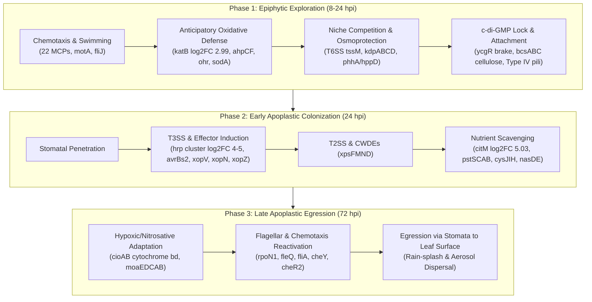

# Xanthomonas perforans

## Overview
*Xanthomonas perforans* (formerly *Xanthomonas campestris* pv. *vesicatoria* group C; also classified as ***Xanthomonas euvesicatoria* pv. *perforans***) is an aggressive Gram-negative phytopathogen causing [[bacterial-spot-tomato-pepper]]. Originally regarded as a tomato-specialized pathotype characterized by foliar "shot-hole" perforations, *X. perforans* has undergone dramatic evolutionary radiation over the past 30 years, replacing *[[xanthomonas-euvesicatoria]]* as the globally dominant bacterial spot pathogen on tomato, expanding its host range to pepper (*[[capsicum-annuum]]*), and acquiring near-universal resistance to copper bactericides.

## Taxonomic History & Reclassifications
- **Current Nomenclature Status**: *Xanthomonas perforans* Jones et al. 2004 / 2006. In revised phylogenomic classifications, it is designated as ***Xanthomonas euvesicatoria* pv. *perforans*** (Constantin et al., 2016).
- **Historical Synonyms & Sequence of Nomenclature Changes**:
  - **1990s**: Discovered in Florida tomato fields exhibiting severe shot-hole foliar lesions. Designated **Group C** of *Xanthomonas campestris* pv. *vesicatoria* based on distinct serological profiles and strong amylolytic activity (Jones et al., 1995).
  - **1995**: Briefly grouped with Group A as *Xanthomonas axonopodis* pv. *vesicatoria* by Vauterin et al.
  - **2004 / 2006**: Jones et al. demonstrated that Group C strains had less than 70% DNA-DNA hybridization relatedness with other xanthomonads and elevated them to species rank: ***Xanthomonas perforans*** sp. nov.
  - **2016**: Multilocus sequence analysis (MLSA/MLST) and whole-genome phylogenomics (Barak et al., 2016) demonstrated that *X. euvesicatoria*, *X. perforans*, and *X. alfalfae* are insufficiently differentiated at the core-genome species level. Constantin et al. (2016) thus reclassified the organism as a pathovar: ***Xanthomonas euvesicatoria* pv. *perforans***.
- **Current Usage**: Both *Xanthomonas perforans* and *X. euvesicatoria* pv. *perforans* are actively used in literature; the standalone species binominal is still predominant in agricultural diagnostics.

## Biology & Morphology
- **Cellular & Colony Traits**: Gram-negative, motile rod with a single polar flagellum. Forms pale yellow, domed, glistening colonies on nutrient agar.
- **Biochemical Properties**: Strongly amylolytic (hydrolyzes starch, distinguishing it from canonical *X. euvesicatoria*) and pectolytic.
- **Ecological Dominance & Competitive Displacement**:
  - **Bacteriocin Warfare**: Strains produce multiple targeted antimicrobial peptides (**bacteriocins** BCN-A, BCN-B, and BCN-C) that actively kill competing *X. euvesicatoria* strains.
  - **Florida Population Takeover**: Prior to 1991, *X. euvesicatoria* was the sole bacterial spot agent in Florida; over ~15 years, *X. perforans* completely displaced it on tomato. In a 2017 statewide survey of 70 commercial fields, 100% of 585 collected strains were *X. perforans* (Klein-Gordon et al., 2021).
  - **Taiwan 27-Year Dynamic**: A long-term study (1989–2016) documented a complete species replacement on tomato in Taiwan: from 95% *X. euvesicatoria* (1989–1999) to 99% *X. perforans* (2010–2016) (Burlakoti et al., 2018).
- **Host Range Expansion**: While long regarded as tomato-specific, *X. perforans* was isolated from commercial pepper fields in Florida in 2010 and Alabama in 2019, and now represents ~8% of pepper spot isolates in Taiwan. In Indonesia, it has even been associated with shoot dieback in non-solanaceous forest seedlings (*Eucalyptus pellita*).

## Molecular Pathogenicity & Virulence Factors
- **Dynamic Open Pan-Genome & Homologous Recombination**:
  - *X. perforans* undergoes extensive genome-wide homologous recombination, actively acquiring genes from *X. euvesicatoria* and *X. alfalfae* (Newberry et al., 2019; Timilsina et al., 2019).
  - This horizontal gene flux has produced multiple distinct genetic lineages differing in effector content, bacteriocin production, and antibiotic resistance.
- **Type III Secretion System (T3SS) & Effector Repertoire**:
  - **[[avrbs2]]**: Highly conserved core effector necessary for apoplastic growth.
  - **XopJ2 (AvrBsT)**: Recent spatiotemporal modeling revealed that strains carrying functional XopJ2 disperse through tomato canopy approximately **three times faster** than near-isogenic mutants with non-functional alleles, providing a powerful fitness advantage that drives directional population shifts (Sharma et al., 2021).
  - **PthXp1**: A novel TALE identified in emerging *X. perforans* lineages. PthXp1 promotes chlorosis and symptom expression in tomato leaves while evading recognition by the classical *Bs3* and *Bs4* immune receptors (Newberry et al., 2019).
  - **AvrHah1**: Acquired in some lineages via horizontal transfer from *X. gardneri*, driving host pectate lyase expression and extensive water-soaking.
  - **AvrXv3**: Recognized by the tomato *Rxv* / *Rx3* resistance locus.
- **Antimicrobial Resistance**: Near-ubiquitous carriage of conjugative plasmids harboring the *copLAB* operon conferring high-level resistance to copper bactericides (see [[copper-bactericides-and-resistance]]) and chromosomal *rpoB* mutations conferring resistance to streptomycin.

## Spatiotemporal Transcriptomic Programming & Infection Life Cycle
A comprehensive in planta spatiotemporal transcriptomic study (Kaur et al., 2026; [[in-planta-bacterial-transcriptomics]]) investigating *X. perforans* strain AL65 on tomato (*[[solanum-lycopersicum]]* cv. FL-47) unraveled the genetic programs coordinating the transition between the leaf surface and the internal apoplast:

1. **Phase 1: Epiphytic Leaf Surface Exploration & Anticipatory Defense (8–24 hpi)**:
   - **Chemotaxis & Motility**: Bacterial cells actively explore the phyllosphere via flagellar swimming directed by 22 methyl-accepting chemotaxis proteins (MCPs) and flagellar motors (*motA*, *motB2*, *fliJ*).
   - **Anticipatory Oxidative Stress Resistance**: In stark contrast to *Pseudomonas syringae* (which triggers ROS defenses predominantly in the apoplast), *X. perforans* induces its primary oxidative stressome **on the foliar surface**: *katB* (catalase, $\log_2\text{FC} = 2.99$), *ahpC*, *ahpF*, *ohr*, *ohrR*, and *sodA*, orchestrated by the OxyR regulon and cytochrome $o$ ubiquinol oxidase (*cyoABCD*). This pre-arms the bacterium against solar radiation, UV-induced ROS, and plant cuticular defenses.
   - **Niche Competition & Host Tolerance**: High expression of Type VI secretion system (T6SS, *tssM*) drives contact-dependent antagonism against resident epiphytic competitors. Phenylalanine catabolism genes (*phhA*, *hppD*) detoxify host-derived phenolic defense compounds, while the potassium pump *kdpABCD* mitigates osmotic stress.
   - **C-di-GMP Molecular Wheel Lock & Surface Attachment**: At 24 hpi, bacteria transition from free-swimming to sessile attachment through c-di-GMP-induced *ycgR* (encoding a PilZ domain-containing flagellar brake that acts as a "molecular wheel lock") and cellulose synthase (*bcsABC*). Type IV pili (*pilGHIJTUMNAWT*) mediate twitching motility to form consolidated microcolonies near stomata.

2. **Phase 2: Early Apoplastic Colonization & Virulence Deployment (24 hpi)**:
   - **T3SS & Effector Burst**: Following entry into the substomatal chamber, *X. perforans* halts surface programs and sharply induces the Type III secretion machinery (*hrp* cluster, *hpaB*, $\log_2\text{FC} \approx 4\text{--}5$) alongside key effectors: [[avrbs2]], *xopV*, *xopN*, *xopZ*, *xopL*, *xopAD*, *avrXv4*, and *avrHah1*.
   - **Cell Wall Maceration**: The Type II secretion system (*xpsFMND*) secretes pectate lyases and cellulases to loosen host middle lamellae.
   - **Countering Host Nutritional Immunity**: Faced with severe nutrient limitation in the apoplast, the pathogen upregulates high-affinity transport systems: *pstSCAB* (phosphate uptake), *cysJIH* and *tauA/D* (sulfur/taurine assimilation), *nasDE* and *amtB* (nitrogen acquisition), and the citrate transporter *citM* ($\log_2\text{FC} = 5.03$).

3. **Phase 3: Late Apoplastic Survival & Stomatal Egression (72 hpi)**:
   - **Hypoxic Adaptation**: As tissue collapses and oxygen becomes depleted, the bacterium switches to cyanide-insensitive cytochrome *bd* ubiquinol oxidase (*cioAB*) and activates molybdenum cofactor biosynthesis (*moaEDCAB*).
   - **Motility Reactivation for Stomatal Egression**: Overturning classical assumptions that flagella remain permanently suppressed during tissue colonization, *X. perforans* **reactivates flagellar synthesis** (*rpoN1*, *fleQ*, *fliA*, *fliC*) and chemotaxis transducers (*cheY*, *cheR2*, *cheA*) at 72 hpi. This reactivated motility enables bacteria to swim out through open stomata back to the leaf surface, ensuring bacterial egression and secondary dispersal via rain droplets.

## Associated Diseases
- **[[bacterial-spot-tomato-pepper]]**: Causes extensive water-soaked spots, severe perforating foliar lesions ("shot-hole"), stem lesions, and sunken unmarketable fruit scabs. Occasionally causes greenhouse pith necrosis in Italy (Aiello et al., 2013).

## Key Research Protocols & Model Strains
- **Model Strain 91-118**: The canonical Race T3 reference genome strain (Florida 1991), sequenced and used to decipher bacteriocin production, T3SS secretion hierarchy, and genomic plasticity.
- **Model Strain AL65**: Highly aggressive field strain from Alabama used for high-resolution dual-compartment *in planta* transcriptomics ([[in-planta-bacterial-transcriptomics]]).

## References & Sources
- Kaur, A., Ramamoorthy, S., Ghosh, P., Weis, K., & Potnis, N. (2026). Spatiotemporal coordination of virulence, metabolism, and stress responses shapes infection dynamics of *Xanthomonas perforans*. *Applied and Environmental Microbiology*, 92(8), e00681-26. [[raw/papers/kaur2026spatiotemporal.pdf]]
- Osdaghi, E., et al. (2021). A centenary for bacterial spot of tomato and pepper. *Molecular Plant Pathology*, 22(9), 1500–1519. [[raw/papers/osdaghi2021centenary.pdf]]
- Potnis, N., et al. (2015). Bacterial spot of tomato and pepper: diverse *Xanthomonas* species with a wide variety of virulence factors posing a worldwide challenge. *Molecular Plant Pathology*, 16(9), 907–920. [[raw/papers/potnis2015bacterial.pdf]]
- Constantin, E. C., et al. (2016). Genetic characterization of strains named as *Xanthomonas axonopodis* pv. *dieffenbachiae* leads to a taxonomic revision of the *X. axonopodis* species complex. *Plant Pathology*, 65(5), 792–806.
- Newberry, E. A., et al. (2019). Independent evolution with the gene flux originating from multiple *Xanthomonas* species explains genomic heterogeneity in *Xanthomonas perforans*. *Applied and Environmental Microbiology*, 85(20), e00885-19.
- Sharma, A., et al. (2021). Need for speed: Bacterial effector XopJ2 is associated with increased of dispersal velocity of *Xanthomonas perforans*. *Environmental Microbiology*, 23(8), 4462–4475.
- Burlakoti, R. R., et al. (2018). Population dynamics of xanthomonads associated with bacterial spot of tomato and pepper during 27 years across Taiwan. *Plant Disease*, 102(7), 1348–1356.
